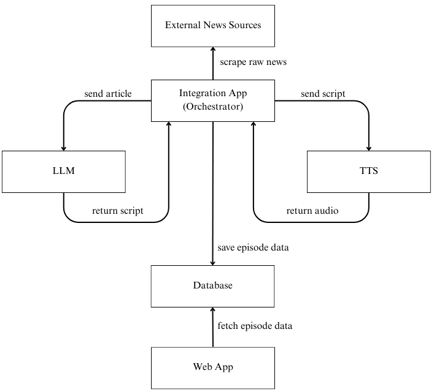
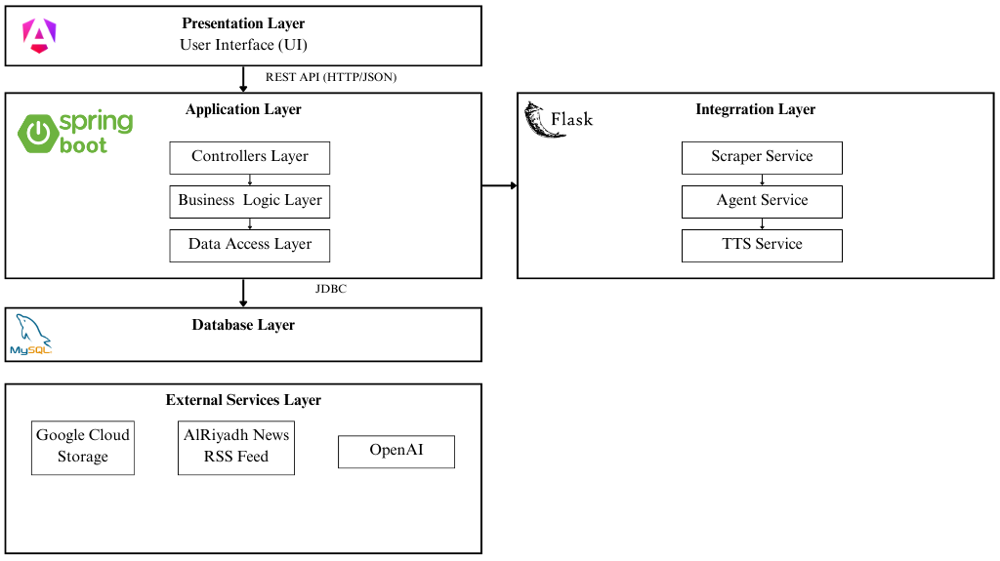

# 3ulum Al-Yawm — Backend

Spring Boot REST API for **3ulum Al-Yawm**, an Arabic news podcast platform. The service stores podcast episodes and article metadata, manages users and listening activity, and connects to the AI agent service that turns daily Arabic news into Najdi-dialect audio.

## Project suite

- **Backend (this repository):** API, authentication, persistence, and pipeline orchestration
- [Frontend](https://github.com/Rmsaah/Arabic_News_Podcast-FE): Angular web application
- [AI and TTS agent](https://github.com/madaweehath/tts-agent-project): scraping, dialect conversion, classification, and speech generation
- [Najdi XTTS v2](https://github.com/wasanalmansour480-oss/Najdi-XTTS-v2): TTS fine-tuning project



## Features

- Public episode browsing, search, and daily featured episodes
- User registration and HTTP Basic authentication
- User profiles, listening progress, history, and statistics
- Episode ratings
- Role-based access for `USER` and `ADMIN`
- Automated episode creation through the Python agent service
- MySQL persistence with Flyway migrations
- Configurable CORS for the Angular frontend

## Technology

- Java 21
- Spring Boot 3.5
- Spring Web, Spring Data JPA, Spring Security, and Validation
- MySQL 8+
- Flyway
- Maven
- MapStruct and Lombok

## Architecture



The Angular client calls this API. The backend persists application data in MySQL and invokes the Python agent at `AGENT_BASE_URL` to generate episode metadata and media URLs.

## Getting started

### Prerequisites

- JDK 21
- MySQL 8+
- The included Maven wrapper, or Maven 3.9+
- The [AI and TTS agent](https://github.com/madaweehath/tts-agent-project) when running the generation pipeline

### 1. Clone the repository

```bash
git clone https://github.com/Rmsaah/Arabic_News_Podcast-BE.git
cd Arabic_News_Podcast-BE
```

### 2. Configure the environment

Required variables:

- `MYSQL_HOST` — MySQL host, such as `localhost`
- `MYSQL_PORT` — MySQL port, usually `3306`
- `MYSQL_DATABASE` — database name
- `MYSQL_USERNAME` — database user
- `MYSQL_PASSWORD` — database password

Optional variables:

- `AGENT_BASE_URL` — agent API base URL; defaults to `http://localhost:8001/api`
- `ALLOWED_ORIGINS` — comma-separated frontend origins; defaults to `http://localhost:4200,http://localhost:3000`
- `SHOW_SQL`, `SQL_LOGGING_LEVEL`, and `JDBC_BIND_LOGGING_LEVEL` — SQL diagnostics

PowerShell example:

```powershell
$env:MYSQL_HOST = "localhost"
$env:MYSQL_PORT = "3306"
$env:MYSQL_DATABASE = "arabic_news_podcast"
$env:MYSQL_USERNAME = "root"
$env:MYSQL_PASSWORD = "your_password"
```

Flyway creates and updates the schema when the application starts.

### 3. Run the API

```bash
./mvnw spring-boot:run
```

On Windows:

```powershell
.\mvnw.cmd spring-boot:run
```

The API runs at `http://localhost:8283`.

## Main endpoints

- `POST /api/auth/register` and `POST /api/auth/login`
- `GET /api/episodes` and `GET /api/episodes/{id}`
- `GET /api/episodes/search`
- `GET /api/home/daily`
- `/api/users/**`, `/api/progress/**`, and `/api/ratings/**`
- `POST /api/admin/automation/create-episode`
- `POST /api/admin/automation/bulk-create-episodes`
- `POST /api/podcast/run-daily-pipeline`

Episode and home reads are public. Profile, progress, and rating operations require a user login; admin automation endpoints require the `ADMIN` role.

## Docker

```bash
docker build -t 3ulum-alyawm-backend .
docker run --rm -p 8283:8283 \
  -e MYSQL_HOST=host.docker.internal \
  -e MYSQL_PORT=3306 \
  -e MYSQL_DATABASE=arabic_news_podcast \
  -e MYSQL_USERNAME=root \
  -e MYSQL_PASSWORD=your_password \
  -e AGENT_BASE_URL=http://host.docker.internal:8001/api \
  3ulum-alyawm-backend
```

> The Spring application listens on port `8283`. Provide production secrets through your deployment platform rather than committing them.

## Tests and formatting

```bash
./mvnw test
./mvnw spotless:check
./mvnw spotless:apply
```
